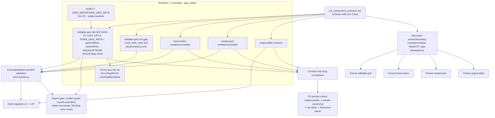

# P2 — Dependency graph và thứ tự triển khai an toàn

Trạng thái: **DRAFT cho Lead review**. Mô tả quan hệ renderer/controller/
generator/validation/domain-rollout cho 4 table component, dựa trên PLAN.md
(kiến trúc generator, Wave T1/P2/P3), manifest `table-manifest-v1` và hiện
trạng `app_web/ui/*`.

> **REBASE 2026-08-26 theo HEAD `bdc2d03`** — node editable-grid đổi từ "gap"
> sang **nền đã khóa** sau merge P1-UI/P1.1/P2.0 (meta form-scoped, activeWhen
> selector/INTERIM, mkGrid deep clone, export conflict guard, focus sau row-op).
> Cập nhật rủi ro export conflict scoped-vs-global và điều kiện chuyển P3.

---

## 1. Đồ thị phụ thuộc



Quan hệ chặn chính:

| Upstream | Downstream | Lý do |
|---|---|---|
| Contract schema | mọi renderer/controller | không code UI trước khi tên trường được khóa |
| Owner chốt selector M72 (theo `m72_activation_proposal.md`) | bỏ INTERIM `minFilledRows` của 5 loop PLI_M72 | INTERIM không phải nguồn xác định loại hình chính thức; cơ chế selector đã sẵn sàng nhận khai báo |
| Conflict guard (`exportLoopsStrict` là chốt duy nhất) | mọi đường export thật | loop cùng tên phải cùng contract export giữa các mẫu (scoped vs global) |
| Renderer fixed-matrix | formula/totals | ô tổng cần ô readonly để gắn computed |
| Validation cross-field | draft migration + export gate | migration phải giữ giá trị computed nhất quán |
| Generator rowspan/colspan | fixture nested-grid/fixed-matrix | fixture sinh từ generator, không sửa tay |
| Fixture + contract test | P3 rollout | Acceptance Gate #3 đòi spec + blocks + test trước rollout |

---

## 2. Thứ tự triển khai P2 đề xuất (tuần tự theo dependency)

Bước nào cũng có thể pause mà không hỏng production: các bước 1–4 chỉ thêm
module mới; bước 5 mới đụng generator (điểm regenerate tập trung của Lead).

1. **Contract** — Lead review + khóa `p2_component_contracts.md` (tên trường,
   severity rule, policy mặc định). Không viết code.
2. **Renderer/controller dùng chung** — theo thứ tự rủi ro tăng dần:
   a. editable-grid phần còn lại (slot cross_field_rules + keyboard/a11y) —
      nền form-scoped meta/activeWhen/focus/conflict-guard ĐÃ CÓ từ
      P1-UI/P1.1/P2.0; mở rộng tiếp mà không đổi GridCtl thuần đã test;
   b. fixed-matrix renderer/controller (dòng cố định + ô tổng readonly);
   c. output-table renderer (đơn giản nhất, không input);
   d. nested-grid renderer/header nhiều hàng — cuối vì phức tạp rowspan.
3. **Formula/totals/cross-field validation** — slot khai báo trong meta,
   validator đọc meta thay vì hard-code; tái sử dụng parseMoney/PERCENT_SUM.
4. **Draft migration + export gate** — bump version draft nếu thêm shape mới;
   gate chặn blocking và recompute tổng lúc export.
5. **Generator: boundary an toàn, rowspan/colspan, totals/STT, idempotency**
   — chỉ Lead chạy regenerate global (`build_form_maps`, templates, blocks)
   sau khi review allowlist diff.
6. **Fixture + contract test cho từng component** — mỗi kind một cặp
   fixture/test theo `p2_fixture_candidates.md`; test đỏ phải sửa ở spec/generator,
   không sửa generated artifact.

Song song hóa an toàn: bước 2a–2d là file/module riêng (một agent sở hữu một
renderer); agent spec/test chỉ bắt đầu sau khi contract đã khóa hoặc làm trên
file tách biệt không chạm generated artifacts (nguyên tắc PLAN P1).

---

## 3. Điểm regenerate tập trung (Lead duy nhất)

Sau mỗi lần đổi spec/generator, CHỈ Lead chạy:

```powershell
python -X utf8 -m tools.build_form_maps --one <FORM_ID>   # thử riêng một mẫu
python -X utf8 tools/docx_to_blocks.py                    # sinh lại blocks
python -X utf8 tools/audit_blocks_check.py                # audit
# full regression + review allowlist diff trước khi commit generated artifacts
```

Agent lane khác KHÔNG regenerate global; vi phạm sẽ gây diff ngoài allowlist
và phá idempotency (Acceptance Gate #8/#9).

---

## 4. Rủi ro tại từng điểm mới

| Điểm mới | Rủi ro | Giảm thiểu |
|---|---|---|
| Export conflict giữa scoped vs global | loop cùng tên được resolve sang meta khác contract tùy mẫu → first-doc-wins âm thầm, payload không phục vụ được hai contract cùng lúc | same-reference short-circuit (mọi mẫu cùng fallback một object = tương đương tuyệt đối); ≥2 reference khác nhau mới so signature (`requirePrimary`/`autoName`/colTags sort/`activationModeOf`); lệch → `EXPORT_LOOP_CONTRACT_CONFLICT`, `exportLoopsStrict` FAIL LOUD là chỗ duy nhất của đường export thật; clone-vs-global cùng signature không flag |
| INTERIM activeWhen PLI_M72 | dữ liệu có thể nằm ở nhiều phần loại hình cùng lúc vì `minFilledRows` kích hoạt từng grid độc lập; chưa phải nguồn pháp lý chính thức | BLOCKED chờ owner chọn option trong `docs/m72_activation_proposal.md` (khuyến nghị Option B); khi chốt chỉ thay activeWhen bằng selector, validator/export guard tự chuyển qua `activationModeOf='selector'` không phải sửa code |
| Form-scoped GRID_META | draft cũ lưu theo loop name phẳng bị đọc sai meta | fallback map cũ + test round-trip draft v2 |
| fixed-matrix computed totals | hai nguồn số liệu mâu thuẫn (nhập tay vs tính) | ô tổng outputOnly, recompute lúc export, blocking khi lệch vốn |
| nested-grid header rebuild | làm phẳng mất cột / lệch rowspan khi xuất DOCX | test so sánh cấu trúc w:tbl nguồn vs xuất (Gate #8); visual QA bắt buộc với mọi nested |
| Generator occurrence (PLI_M72) | nhân bản bảng khi chạy lại, xóa nhầm bảng kế | boundary `end_markers`, idempotency test chạy 2 lần giống byte |
| Draft migration | mất dữ liệu người dùng khi đổi shape | migration additive-only, giữ `_row_id`, có test dữ liệu cũ |
| Export gate siết thêm | hồ sơ cũ hợp lệ bỗng bị chặn | liệt kê rule mới vào release note; severity warning trước khi nâng blocking |

---

## 5. Điều kiện chuyển P3

P3 (capital-assets → people-ownership → tax-grids → branches-admin) chỉ mở
khi: contract đã khóa, cả 4 component có ít nhất một fixture pass contract
test, full regression xanh và Lead đã regenerate sạch allowlist. Bổ sung sau
rebase 2026-08-26: owner phải chốt selector loại hình M72 theo
`docs/m72_activation_proposal.md` (khuyến nghị Option B) để bỏ INTERIM
`minFilledRows` của 5 loop PLI_M72 — nếu không, rollout domain chạm tới PLI_M72
vẫn chạy trên cơ chế tạm. Trạng thái BLOCKED_LEGAL_REVIEW của từng form vẫn
chặn rollout tương ứng dù P2 hoàn tất (xem `legal_review_backlog.md`).

Giới hạn ghi nhận tại HEAD (chưa xử lý): `tools/census/p1_b_verify_m72.py`
FAIL sẵn vì kỳ vọng tiền-integrate (đòi giữ paragraph tiêu đề cột tan dư trong
vùng đã rebuild thành `w:tbl`) mâu thuẫn thiết kế drop của spec PLI_M72 — cần
owner quyết định sửa gate cũ hoặc bỏ; PLI_M15 bảng phẳng từ NGUỒN (L0-B);
PLII_M02 blk72/129 bảng thành viên nén paragraph (L0-C).
